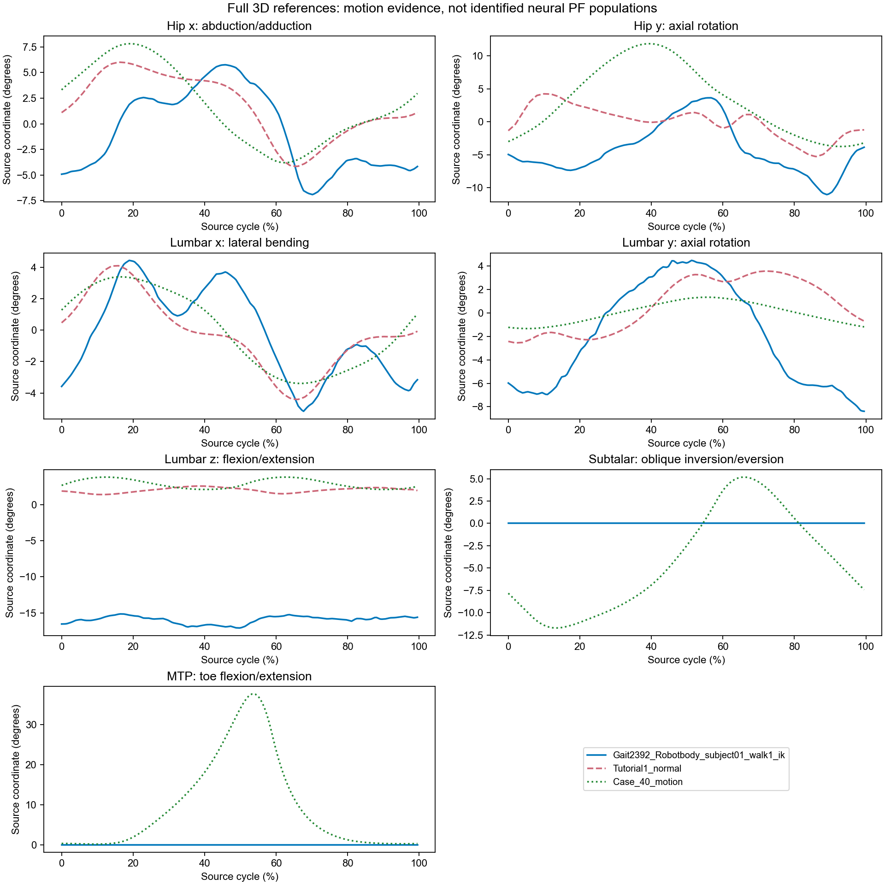

# Full 3D IK and PF-pattern audit

Machine: easteregg2. This is training evidence for the complete Gait2392 model, not a sagittal restriction.

## Scope and source limitations

The 43 cached references retain only sagittal hip/knee/ankle curves. All ten Ong references are planar predictions from a nine-DoF model with lumbar motion locked, so they cannot support independent out-of-plane/lumbar PF patterns. The original 32 running-trial full files are not present on this machine; their discarded coordinates cannot be reconstructed from caches. No multi-subject full-3D conclusion is claimed.

Three complete motion files were analyzed: the experimental subject01 IK, the illustrative Gait2392 normal example, and the recovered Falisse Case_40 prediction. The latter is not experimental IK. Its source commit and file hashes are in ignored runs/ik_sources/falisse_manifest.json.

| Coordinate | Experimental IK RoM | Normal example RoM | Falisse prediction RoM | Native muscles with >1 mm leverage |
|---|---:|---:|---:|---:|
| Hip x: abduction/adduction | 13.833 deg | 10.170 deg | 11.602 deg | 27 |
| Hip y: axial rotation | 17.384 deg | 9.510 deg | 15.561 deg | 27 |
| Lumbar x: lateral bending | 9.628 deg | 8.520 deg | 6.782 deg | 6 |
| Lumbar y: axial rotation | 13.616 deg | 6.130 deg | 2.672 deg | 6 |
| Lumbar z: flexion/extension | 3.655 deg | 1.180 deg | 1.708 deg | 6 |
| Subtalar: oblique inversion/eversion | 0.000 deg | missing | 16.907 deg | 12 |
| MTP: toe flexion/extension | 0.000 deg | missing | 37.540 deg | 4 |

## What this supports

- Retain distinct controllable hip frontal/axial and lumbar x/y/z channels. They can share the RG clock while having separate PF distribution, sensory gains, and motor recruitment. Distinct movement is not proof of an independent oscillator.
- The tutorial normal example sets all three lumbar coordinates exactly opposite the corresponding pelvis rotations (sum standard deviation zero). That is imposed trunk stabilization, not independent evidence of three new rhythm generators. The experimental lumbar curves are not that exact identity.
- Both subtalar and MTP coordinates in the experimental IK are explicitly targeted to their zero defaults by applied IKCoordinateTasks with weight 1000. The model coordinates are unlocked. Flat curves therefore reflect the IK setup, not absent human motion or absent neural control.
- The native Gait2392 model has four muscles per MTP and twelve per subtalar joint with nontrivial leverage over the sampled poses. These joints are mechanically controllable. Their periodic targets are not identified by the experimental zero-default solution.
- Falisse predicts approximately 37.5 degrees of MTP and 16.9 degrees of subtalar excursion. However, that model changed the toe axis and its toe actuation is passive. Its toe motion does not prove an active MTP PF pattern. The native model instead retains an oblique MTP axis and muscle authority.
- The native subtalar axis has a substantial anatomical-y component as well as x. Control its actual joint coordinate; do not manufacture a pure x hinge. The native MTP axis is also oblique, unlike the modified Falisse axis.

A sample-holdout sagittal regression was included as a descriptive dependency check only. It is not subject-level cross-validation or a neural model-selection test. Independent-subject activation/force data and perturbations remain necessary before claiming new biological primitives.

## Sign and training corrections

Actual source/OpenSim and converted/MuJoCo forward-kinematics perturbations require -1 for bilateral hip flexion/adduction and +1 for the remaining leg/lumbar coordinates. This replaces the old training data sign guesses only in the new campaign. All 17 joint coordinates remain free. Full root/frame and target retargeting assumptions are recorded in runs/targets/metadata.json.

The initial inverse-force target reconstruction uses native equality-aware moment arms, bounded native muscle activation, and force-velocity effects. It retains all 17 coordinates and uses an explicitly supported-in-place load reference. It is an engineering training target, not a new measurement of human muscle activation.

Primary sources: [Falisse et al. 2022](https://doi.org/10.1371/journal.pone.0256311), [author model/results](https://github.com/antoinefalisse/predictsim_mtp), and [Ong et al. 2019 model scope](https://doi.org/10.1371/journal.pcbi.1006993). Local source: Solid_Models/OpenSim/Gait2392_Robotbody/subject01_Setup_IK.xml.
