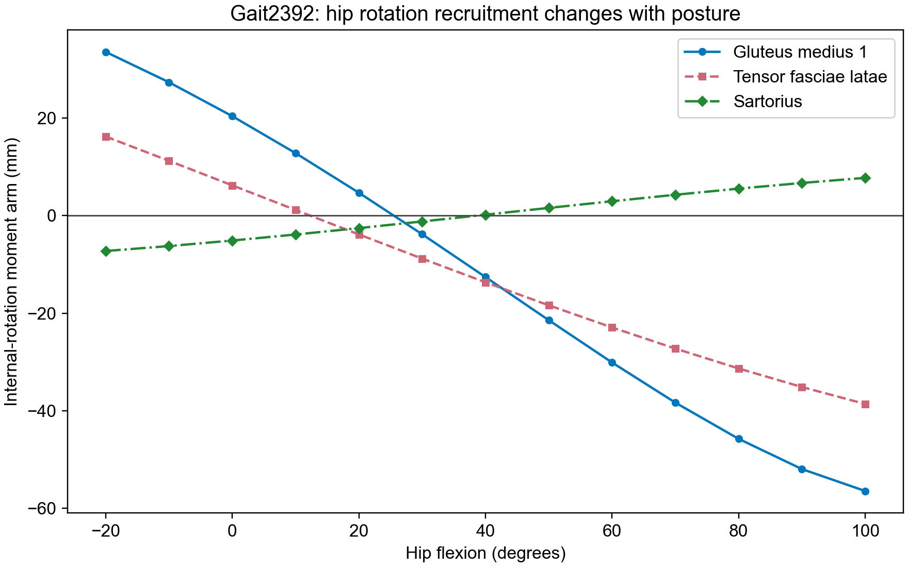
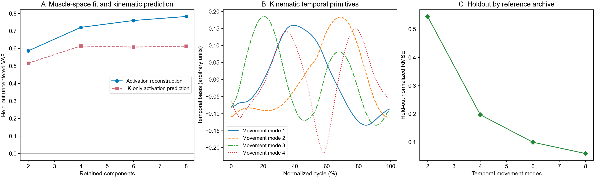

# Gait2392 functional PF experiments — Session 1

Machine: **easteregg2**. Repository: `D:\GitHub\Bipedal_Robot`.

## Outcome

Implemented and tested optional biarticular and anatomical-axis PF circuits on the articulated **human Gait2392 model**. Construction and numerical checks pass. The completed experiments do **not** establish improved walking. In particular, antiphase RG activity is insufficient: physical knee cycles still fail the late-window alternation gate. The combined ground trial has no detected left-leg cycles. No candidate is promoted to a production winner.

The AH001 CAD robot remains a separate supported hybrid demonstration. Its launcher is `D:\GitHub\Bipedal_Robot\Code\MuJoCo_SNS\robot_torso\Launch_AH001_Replay.cmd`; double-click on easteregg2. This opens the saved MuJoCo demonstration, not Simscape. The neighboring PowerShell launcher accepts `-RunNew` to reproduce the saved simulation settings before opening the viewer. The viewer itself has not been launched by this session.

## Controller construction

The experimental controller inherits **w2lvar**, retaining its RG, original hip/knee PF circuits, commissural wiring, and muscle afferent/reflex pathways. It introduces no motor-neuron current cancellation or extra support forces.

Each additional PF module contains **two excitatory PF cells and two inhibitory relays**, with PF → same-side relay → opposite PF inhibition. These are graded conductance neurons.

| Added channels | Modules | Purpose |
|---|---:|---|
| Hip X and Y, and subtalar X, per leg | 6 | Signed frontal-plane, rotational, and foot recruitment |
| Lumbar X, Y, and Z, one global set | 3 | Side bending, axial rotation, and extension/flexion |
| Separate ankle sagittal PF, per leg | 2 | Decouple ankle drive from the old shared knee/ankle drive |
| HAM, RECT, SAR, GRAC, TFL, and GAS, per leg | 12 | Dedicated stance/swing channels for 18 verified biarticular routes |

Combined architecture: **980 neurons, 400 input ports**, versus 888/382 in the configured w2lvar baseline. The optional temporal-primitive variant uses the same 980 neurons and **424 input ports**, replacing RG-to-biarticular-PF conductances with RG-phase-decoded waveform inputs. The initialization-pulse experiment adds one input port to these counts.

HAM covers semimembranosus, semitendinosus, and biceps femoris long head; GAS covers both gastrocnemius compartments. Each family has an independent PF module per leg. A family's stance and swing cells recruit that family in different phases; they are not described as an anatomical antagonist muscle pair. Long toe flexors/extensors remain on the ankle and foot functional pathways; this implementation does not claim dedicated modules for every multiarticular foot muscle.

The old toe-dorsiflexor inhibition is redirected from knee flexion to the newly separate ankle dorsiflexion PF. The selected biarticular muscles receive their own PF drive instead of the old hip/knee PF drive. Their existing autogenic pathways remain, with small Ia/II projections into the new swing PF, and their reciprocal-inhibition phase gates follow that PF.

## Mechanics and coordinate verification

Model: `D:\GitHub\Bipedal_Robot\Solid_Models\OpenSim\Gait2392_Robotbody\mjc\gait2392_simbody\gait2392_simbody_cvt3.xml`. This is the unscaled articulated human model, not the CAD robot or the 54-route robot-body model.

The existing converted model retains its legacy z-up world. The explicit world adapter is OpenSim/ISB `(x,y,z)` → legacy MuJoCo `(x,-z,y)`; anatomical coordinates remain **x anterior, y superior, z right**. Existing gravity, contacts, support, and the runner's **2 ms implicitfast physics/neural step** are preserved for matched comparisons. The source XML's unpatched timestep is not the simulation timestep.

Equality-dependent coordinates are included in the torque projection. The analytic tangent projection and central finite differences of reprojected muscle lengths agree to **2.183e-11 m** maximum moment-arm error. This avoids repeated per-coordinate forward evaluations during the simulation.

Across the sampled hip-flexion sweep, −20° to 100°, **26 muscle compartments change their hip-rotation moment-arm sign**. Runtime recruitment uses measured signed torque moment arms; both the SNS matrix and the accelerated backend's cached edge array are refreshed every 10 ms. This is an engineering recruitment rule, not a physiological identification result. TFL-right switches between the two hip-rotation PF channels at opposite ends of the sweep.

The converted joints named `hip_adduction_r/l` have positive *abduction* in this particular model. This was checked independently by ±0.001-rad perturbations and calcaneus displacement relative to the pelvis: rightward derivatives +0.86765 m/rad on the right and −0.86765 m/rad on the left. Accordingly, this implementation follows measured mechanics, not coordinate names. Subtalar inversion/eversion retains its actual oblique axis rather than imposing an artificial pure-X hinge. See `axis_conventions.json` and `primitive_verification.json`.



## Movement primitives and muscle synergies

The analysis separates kinematic PCA modes from nonnegative muscle-activation factors. Three contiguous held-out time blocks distinguish reconstruction of held-out muscle activations from predicting those activations using only IK coordinates/velocities. At rank six, mean uncentered VAF is **0.760 for activation reconstruction**, versus **0.608 for IK-only activation prediction**. The former uses held-out activations to infer coefficients; it is not an IK prediction result.

Temporal kinematic modes are also fitted and evaluated across the existing gait-reference archives, separately from muscle-space factors. Archive holdouts can share subjects and speeds; they are not unseen-subject validation.

The paired IK/activation record covers **only two seconds**. Activations come from a quasi-static IK + measured-GRF back-solve, **not measured EMG**. The existing unscaled model and source subject are not anthropometrically matched; the previously documented scale/foot-height mismatch limits interpretation. These factors are engineering seeds and do not identify independent biological modules or establish dynamic feasibility.

The optional temporal-primitive controller preserves smoothed, phase-dependent biarticular activation waveforms instead of reducing each family to two mean values. RG transitions determine phase resets and duration estimates; a phase saturates when switching stops. There is no independent repeating clock. Spatial PF-to-MN recruitment remains separate from the temporal waveform. Waveforms and interpolation grids are cached before the simulation loop.



## Simulation results and acceptance

Raw trial configurations, complete metrics, neural/physical traces, and source snapshots are under `trials/`; compact outcomes are in `trial_summary.json` and `stage_assessments.json`. Trials use recorded w2lvar seeds and bounded engineering gain changes. **This is staged diagnosis, not a completed five-stage curriculum optimization.**

Without an initialization cue, the deafferented RGs synchronize. A finite **2 nA left-RG excitation from 2.0–2.5 s** produces antiphase RG activity for the stage-five seed (RG difference correlation about −0.565). The numerical pulse is an engineering initialization choice, not a fitted literature parameter.

Matched isolated-air tests disable muscle afferents and the added joint-angle feedback. Variants include baseline, axis-only, biarticular-only, combined, biarticular gain 0.3–2.0, a shorter NaP time constant, and temporal-primitive gains 0.5 and 1.0. Earlier exploratory `air_deaff` tests with added joint feedback enabled are only partial sensory isolation.

The default biarticular/combined circuits reduce late knee excursion from about **133° per leg** in the isolated baseline to about **102°/98°**, but do not yield consistently alternating physical cycles. Temporal waveform drive also fails the physical alternation gate. All such negative outcomes remain in the evidence; air-mode sentinel score −25 is not used to rank them.

The acceptance gate requires finite full-duration simulation, bilateral RG bursts, antiphase RG correlation, bilateral physical cycles, bounded late knee excursion, and repeated opposite-leg knee peaks within 20–80% of the other leg's cycle with at least 80% cycle coverage. These are explicit engineering air-pattern screening criteria, not a published walking definition.

Additional combined-controller trials enable afferent feedback, run eight seconds of supported standing, and attempt sixteen seconds of ground locomotion:

| Diagnostic | Completion | Detected R/L cycles | Displacement | Kinematic score |
|---|---:|---:|---:|---:|
| Combined, afferented air | 16 s | 2/3 | +0.060 m, rig-supported | −355.35 |
| Combined, ground | 16 s | 6/0 | +0.037 m | −246.01 |
| Matched baseline, ground | 16 s | 7/5 | −0.079 m | −174.23 |

The combined controller worsens the matched ground outcome and does not qualify as bilateral walking. The standing trial completes eight seconds and reports mean foot-normal-force/body-weight **0.575**, with **0.425 inferred residual support share**, using the runner's steady-window metric. These are force-based proxies rather than direct harness-force measurements. Maximum torso tilt is about **30.2°**, so completion is not accepted as a satisfactory balance result. Ground force ratios exceed one in these dynamic trials; their negative residual shares must not be interpreted as literal negative harness support. Ground-mode air-pattern flags do not establish walking.

## Acceleration and regression checks

Trials use `PreallocatedExactForward`: sparse Numba conductance operations, retained dense NumPy reduction order, reused buffers, and direct one-hot input/output handling. Previous family audit measurements and six-family/body parity tests are in `..\reports_20261028_family_audit\AUDIT_REPORT.md`; no new blanket real-time claim is made here. Model-aware moment arms use a preallocated equality-aware tangent projection.

The standard combined and primitive neural checks each compare **200 steps** against the SNS reference backend with zero maximum voltage difference at fixed mechanics. Both caches correctly update for a posture-dependent sign switch. Primitive inputs are zero with zero descending drive. This does not assert full-trajectory reference equivalence for the newly time-varying controller.

The only production-runner change is an optional `bind_mujoco(model,data)` hook after network construction. Existing families do not implement it. The unchanged s3k anchor remains **−161.56754173676563**; `default_baseline_verification.json` checks saved arrays against the earlier preallocated baseline. Production builders, parameter files, winner JSONs, databases, dissertation prose, and the defense deck are not changed by these experiments.

## Literature relationship

Separate RG and PF levels follow the architectural distinction in [Rybak et al. (2006)](https://pmc.ncbi.nlm.nih.gov/articles/PMC1890439/). These added modules are engineering extensions, not reproductions of its full circuit. Existing w2lvar pathways and the finite initialization cue can be compared with [Deng et al. (2019)](https://pmc.ncbi.nlm.nih.gov/articles/PMC6477610/), without claiming parameter or topology identity.

The distinction between temporal activation patterns and muscle-space recruitment is informed by [d'Avella et al. (2003)](https://doi.org/10.1038/nn1010) and [d'Avella and Bizzi (2005)](https://www.web.mit.edu/bcs/bizzilab/publications/davella2005.pdf). The present decomposition is not an experimental test of their biological conclusions. The hip-angle dependence of rotational action is consistent in principle with [Delp et al. (1999)](https://pubmed.ncbi.nlm.nih.gov/10327003/); this sweep verifies the converted model, not an independent anatomical dataset.

## Reproduction

On **easteregg2**, use `D:\Anaconda\envs\myo\python.exe` and work in `D:\GitHub\Bipedal_Robot`. For example:

```powershell
& 'D:\Anaconda\envs\myo\python.exe' 'D:\GitHub\Bipedal_Robot\Code\MuJoCo_SNS\spinal\functional_gait2392\trial.py' combined --stage ground --kick 2 --label my_new_combined_ground
```

Labels must be new: the driver refuses to overwrite existing trial evidence. `--stage air_deaff --feedback 0` is required for complete isolation of the new joint feedback. Use `--curriculum-seed` to load the corresponding recorded stage seed; this does not itself optimize that stage. `prepare.py`, `axis_audit.py`, and `analyze_primitives.py` regenerate the mechanics and decomposition evidence. `verify.py` and `verify_primitive.py` check construction; `assess.py` and `summarize.py` regenerate outcome summaries.

Next useful work is retargeting a matched IK/GRF reference to this exact model, then optimizing the new PF pathways against physical alternating-cycle gates. Additional PF cells alone have not solved the baseline's motor recruitment and mechanical tracking problems.
