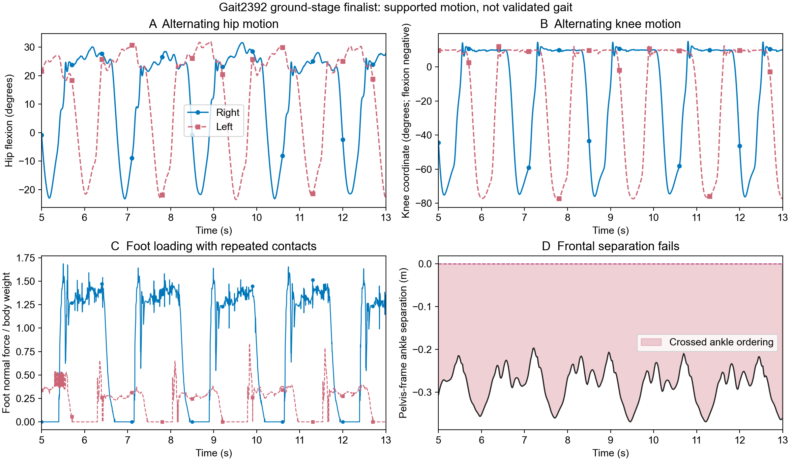

# Functional PF curriculum: final audit — Session 1

**All five stages were run, 100 trials each. Actual bilateral alternating motion was obtained, but the final air and ground candidates do not qualify as valid three-dimensional gait.** The final air and ground winners reproduce their original motion screens in 8/8 one-percent perturbations each. Both fail the added frontal-separation check in every perturbation. Standing also remains unsatisfactory.

Machine: **easteregg2**. Repository: `D:\GitHub\Bipedal_Robot`. Model: articulated human Gait2392, not the CAD robot.

## Five-stage results

| Stage | Trials | Full-duration finite runs | Original screen passes | Fresh winner result |
|---|---:|---:|---:|---|
| 1: Deafferented air, interleg off | 100 | 99 | 0 | Fails original screen |
| 2: Afferented air, interleg on | 100 | 99 | 0 | Fails original screen |
| 3: Supported standing | 100 | 90 | 0 | Fails original screen |
| 4: Air stepping | 100 | 86 | 22 | Passes original screen; fails frontal audit |
| 5: Ground contact | 100 | 81 | 64 | Passes original screen; fails frontal audit |

“Original screen” refers to the frozen objective in `functional_gait2392/curriculum_metrics.py`. Its `accepted` field is retained unchanged in raw results. It checks actual knee/hip excursions, physical cycle counts, phase, cadence, and finite completion; standing has separate posture/load checks, and ground adds loading/duty checks. It did not include frontal separation. The later audit corrects that omission without relabeling old raw evidence.

Each stage carries its winner into the next. Because earlier gates failed, the later runs are recorded as attempted downstream stages, not proof that the entire curriculum was successfully graduated. Six small-feedback continuation seeds and six amplitude-continuation seeds are saved explicitly.

## Actual motion obtained

Final air winner: trial 85, 5/5 late-window knee cycles, period 1.746 s, mean half-cycle phase error 0.0009, knee excursions 86.4/86.3 degrees.

Final ground winner: trial 80, 5/5 late-window knee cycles, period 1.750 s, mean half-cycle phase error 0.0061, knee excursions 94.0/90.3 degrees, and hip excursions 56.4/55.5 degrees.

Ground kinematic score is -144.573; displacement is only 0.058 m over the supported run. The fixed support and objective do not establish forward locomotion. The force-onset detector counts 8/13 loading cycles, versus five physical knee cycles per side; repeated contacts are not additional strides. Contact duty is 0.642/0.708.

The selected ground rig scale is 0.948. This scales spring stiffness and damping; it is **not a fraction of body weight supported**. The optimized pelvis height and support differ from older baseline conditions, so the score is not an isolated causal comparison of neural architectures.



## Why gait is not accepted

Stage 4 fresh winner, corrected anatomical axis: minimum ankle separation -0.080 m, crossed ankle ordering during 19.5% of sampled late motion, and minimum knee separation -0.086 m.
Stage 5 fresh winner, corrected anatomical axis: minimum ankle separation -0.370 m, crossed ankle ordering during 100.0% of sampled late motion, and minimum knee separation -0.168 m.

Correction: the earlier audit accidentally rotated world -y as a pelvis-local vector, producing a nearly vertical measurement. Those widths and percentages are withdrawn. Separation now uses pelvis-local +z, verified from bilateral hip anchors and neutral/crossed-pose tests. Neutral ankle and knee separations are 0.18284 m and 0.167 m. Raw trajectories and sagittal/contact results are unchanged. This is a body-origin crossing screen, not a full mesh self-collision test. See `../literature_training_review/corrected_frontal_reaudit.json` and `frontal_gate_verification.json`.

The first air-screen winner passed only 3/8 perturbations. The final air and ground winners each pass 8/8 original-screen perturbations, but 0/8 frontal checks. `final_basin/SUMMARY.json` contains every result. Perturbations change every saved scalar by an independently sampled ±1%, including inherited/inert fields and posture/support settings; zeros remain zero. This is a local screen, not broad robustness or generalization validation.

Standing trial 75 completes eight seconds, but maximum tilt is about 24.8 degrees, displacement from the foot reference is about 0.137 m, and the foot-normal-force ratio is about 0.384 with almost all loading on one side. Separate symmetric starts reduce tilt to approximately 12–14 degrees and equalize contact, but still have large displacement and low foot loading. No satisfactory independent standing or harness-free walking result is established.

## Neural contribution and architecture

The controller has 980 neurons, with separate four-cell modules (two PF cells and two inhibitory relays) for the added axis and biarticular channels. There are 23 additional modules: nine axis modules, two separate sagittal ankle modules, and twelve bilateral biarticular-family modules. It drives the human model through native SNS motor outputs. Standing NNLS bias, existing balance feedback, and the mechanical support remain engineering components; no CAD-style motor-neuron target-current cancellation is used.

Deleting direct biarticular PF-to-MN drive after 8 s preserves every saved pre-intervention state exactly. Saved motor commands then change by up to 1.00000 in the first 100 ms and 1.00000 later; joint coordinates diverge by up to 55.93 degrees. This verifies a causal contribution of the new biarticular PF drive. It does not prove that every added pathway improves gait.

A separate isolated hip-X pathway test verifies input-port identity and opposite torque signs. At its neutral test pose, the positive channel produces about +66.2 N·m in the native frontal coordinate and the negative channel about −100.0 N·m, after subtracting passive torque. Both also produce flexion torque, showing the multi-axis coupling. Other MN inputs are silenced only for this unit measurement; that silencing is not used in controller runs.

## Corrective experiments retained separately

Stronger global axis gains, isolated hip-X feedback, shorter PF/relay time constants, extra damping, stronger position feedback, model-aware inhibitory relays, and reduced inherited frontal-muscle pattern drive were tested outside the frozen curriculum. A nonnegative recruitment fit uses model-measured unit-activation force capacity over 16 recorded poses to target frontal torque while penalizing other joint torques. These are engineering candidates, not identified biological synergies. Their earlier frontal rankings used the incorrect axis and are withdrawn pending separate re-audit. The two final selected controllers and all 16 final perturbations have been rechecked and still fail the corrected frontal gate. Prototype configurations, results, and source variants remain separate and are not promoted to production winners.

## Acceleration and regression

The sparse Numba backend retains NumPy’s contiguous pairwise summation tree, uses preallocated buffers, and preserves the fixed-tau channel equations. Its 980-neuron 1,000-step check is bit-exact and measures 11.23× the neural stepping throughput of the preceding preallocated implementation. This is a neural-kernel measurement.

Every saved array of a complete moving-leg pilot and a complete afferented comparison remains bit-exact. Observed pilot wall times changed from 69.51 s to 15.86 s, and afferented wall times from 113.74 s to 34.59 s; concurrent load differed, so these wall-time observations are not controlled whole-simulation speed ratios. There is no blanket faster-than-real-time claim.

The protected s3k anchor remains -161.56754173676563, and every common saved array matches its earlier baseline exactly after the optional runner changes. Source/model physics remain MuJoCo 2.3.7, implicitfast, and 2 ms. Existing human conversion placement is legacy z-up with the explicit anatomical adapter; no silent world-frame reinterpretation was made.

## Files and reproduction

- `FINAL_SUMMARY.json`: complete stage outcomes, final robustness, and causal check.
- `stage1_best.json` … `stage5_best.json`: full saved parameters, original objective, and fresh replay.
- `trials/`: unique per-trial configurations, logs, raw trajectories, and result JSON.
- `source_manifest.json` and `sources/`: frozen campaign source hashes and copies.
- `final_basin/`, `causal_validation/`, and `*_probes/`: explicitly separated validation and corrective experiments.
- `air_t0002_media/`: diagnostic recorded-state GIF/still; this older candidate crosses its legs and is not defense evidence of valid gait.

On easteregg2, resume an unchanged campaign with:

```powershell
& 'D:\Anaconda\envs\myo\python.exe' 'D:\GitHub\Bipedal_Robot\Code\MuJoCo_SNS\spinal\functional_gait2392\curriculum.py' --trials 100 --workers 4 --campaign curriculum_20261028_v1
```

The completed study will not add trials at that target. Changed sources require a new campaign name. Do not overwrite production winners or infer valid gait from the old `accepted` flag alone. No commits, pushes, dissertation source edits, or deck changes were made in this campaign.
