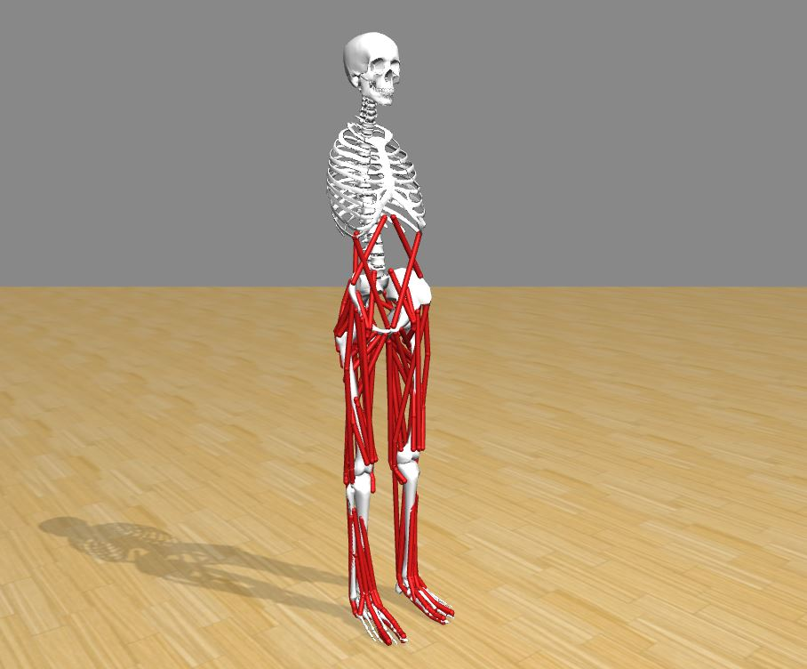

# Bipedal Robot

The Agile and Adaptive Robotics Lab at Portland State University develops a bipedal robot driven by braided pneumatic actuators. This repository contains the mechanical designs, actuator measurements, and software used to compare human and robot joint mechanics and to test neural controllers.

## Project files

| Area | Contents |
| --- | --- |
| [Mechanical designs](Solid_Models/) | SOLIDWORKS parts and assemblies for the leg and knee test fixture, fabrication geometry, and OpenSim musculoskeletal models. |
| [Actuator measurements](Testing_Data/) | Force, pressure, joint-angle, and knee-torque measurements, calibration data, and MATLAB analysis scripts. |
| [Knee route optimization](Code/Matlab/Mesh_Optimization/) | MATLAB functions for actuator placement, pulley geometry, and comparison with reference human torque curves. |
| [Load-cell acquisition](<Code/Matlab/HX711 v3.0/HX711 v3.0/README_HX711_BPA.md>) | Hardware setup, pressure control, calibration, and an offline application test. |
| [Neuromechanical simulations](Code/MuJoCo_SNS/README.md) | MuJoCo, SNS-Toolbox, and pneumatic-actuator simulation examples. |
| [SNS-Simscape](Code/Matlab/SNS_Simscape/README.md) | Simulink block libraries and examples that connect neural activity, muscle force, and joint motion. |
| [AH001 robot model](Neuromechanical_Models/AH001_MuJoCo/) | MuJoCo model assembled from the robot CAD, with its articulated feet, meshes, and tendon routes. |
| [Sensory Afferent Database Explorer](Code/SADb_Explorer/) | Offline literature browser with a sortable table, pivot tables, and a citation map. |

## Contributors
Ben Bolen - Project Co-Lead, PhD Student

Connor Morrow - Project Co-Lead, PhD Student

Harold Omotoy - Muscle Placement and PAM Testing, Undergraduate Researcher

## Previous Contributors
Alex Steele - Knee Joint Designer, Past Master's Student

Ty Fitzgerald - Ankle and Foot Design, Undergraduate Researcher 

David Pleshakov - Lower Body Design, Undergraduate Researcher

Mick Leungpathomaram - Various SolidWorks components and assemblies, High School Research Intern

Alaina Clar - Various SolidWorks components and naming convention creator, High School Research Intern
